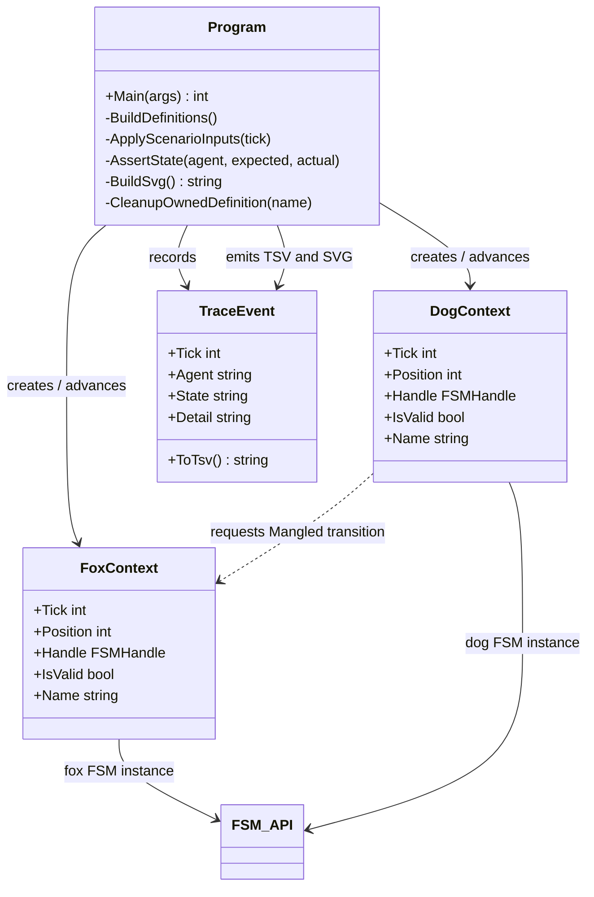

# Foundry Fox/Sheepdog UML

**Status:** manually authored from the current source; not generated.

## Class and collaboration view

## Use case: verify a deterministic interaction in CI

1. Create two uniquely named FSM_API definitions and their contexts.
2. Advance a fixed six-tick scenario with scripted inputs.
3. Assert the fox and dog visit expected states, including the dog's cross-FSM request.
4. Return a non-zero process result if any assertion fails.
5. Compare evidence generated by two fresh processes and retain the trace and SVG as CI artifacts.

## Evidence boundary

The state transitions are executed by the real FSM_API package. The tick inputs are scripted for reproducibility; this is not yet a general-purpose simulation engine, live browser control, or the original SimpleDemos interactive loop. The SVG visualizes events recorded by the C# run and does not decide FSM behavior.
