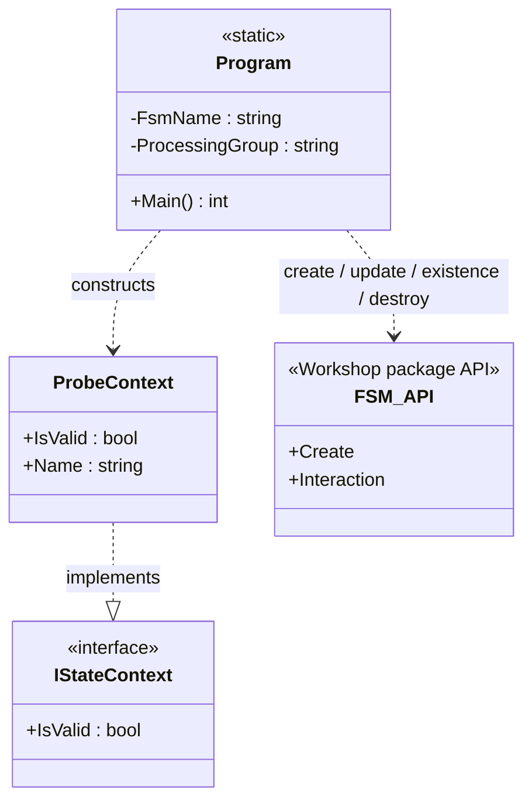

<!-- The Singularity Workshop moniker -->

# Program — UML Neighborhood

**Status:** manually maintained, source-grounded view of the first CI probe. Not generated output.

## Class diagram

## Relationships and evidence

- `Program.Main` defines `Ready` and `Complete`, sets `Ready` as initial state, registers the `Ready -> Complete` transition, creates one instance, calls `Interaction.Update`, and checks `CurrentState`.
- `ProbeContext` implements `IStateContext` and supplies `IsValid` and `Name`.
- Cleanup is scoped to the fixed probe name and processing group. The probe never invokes the global reset API.
- `FSM_API` is a dependency supplied by NuGet package `TheSingularityWorkshop.FSM_API` version `1.0.13`.

## Use case

**CI proves the real package is usable:** restore the published package, compile the probe, execute one deterministic state transition, fail the job if an assertion fails, and retain the output artifact.

## Scope boundary

This diagram describes the probe only. It does not imply that Foundry has a workflow manifest, general-purpose execution runtime, FSM_COS integration, or failure/recovery engine.

---

<!-- THE SINGULARITY WORKSHOP FOOTER -->

