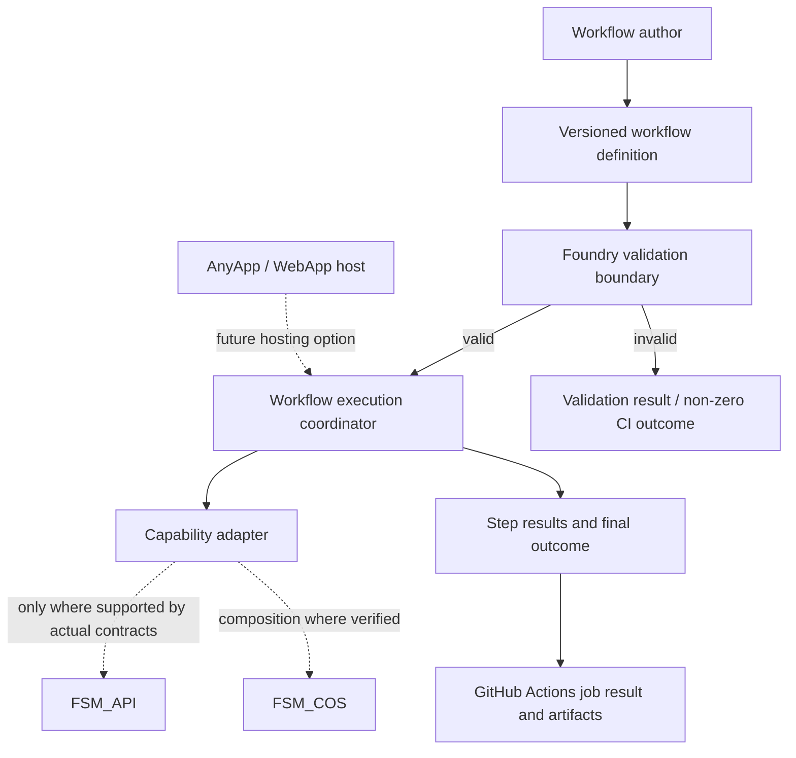
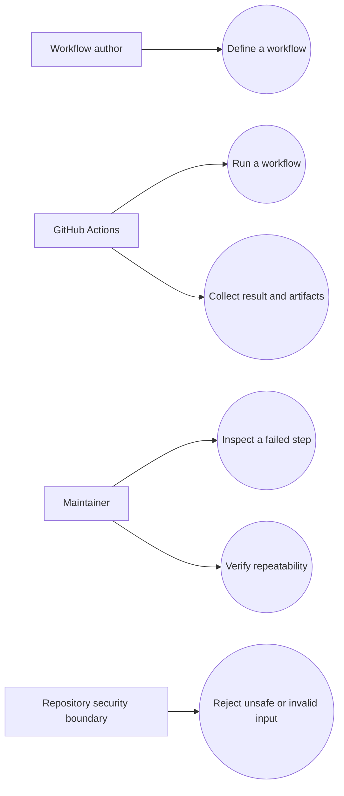

<!-- The Singularity Workshop moniker -->

# Foundry Architecture UML

> **Diagram status: CONCEPTUAL TARGET — not a diagram of implemented classes or a verified runtime.** No source types are inferred from this drawing.

## Target component flow

Solid arrows show the intended control flow. Dashed links are integration options that must be confirmed against the real APIs before implementation. This drawing does not claim those adapters or the execution coordinator exist.

## Use cases

These are intended goals for the first experiment. Validate and refine them as runnable behavior and tests are added.

## Questions to settle from source evidence

- What public FSM_API surface is appropriate for expressing or executing workflow states?
- What does FSM_COS currently compose, and what does it not yet do?
- Is a dedicated Foundry execution runtime justified, or is a thin adapter enough?
- How should step outputs, failure causes, cancellation, and timeouts be represented?
- Which pieces belong in a host, a reusable package, and the CI workflow?

Do not add class diagrams until actual source types exist. Once they do, create a separate `[TypeName]UML.md` neighborhood page for each significant type and companion documentation for source files according to the Workshop standard.

---

<!-- THE SINGULARITY WORKSHOP FOOTER -->

