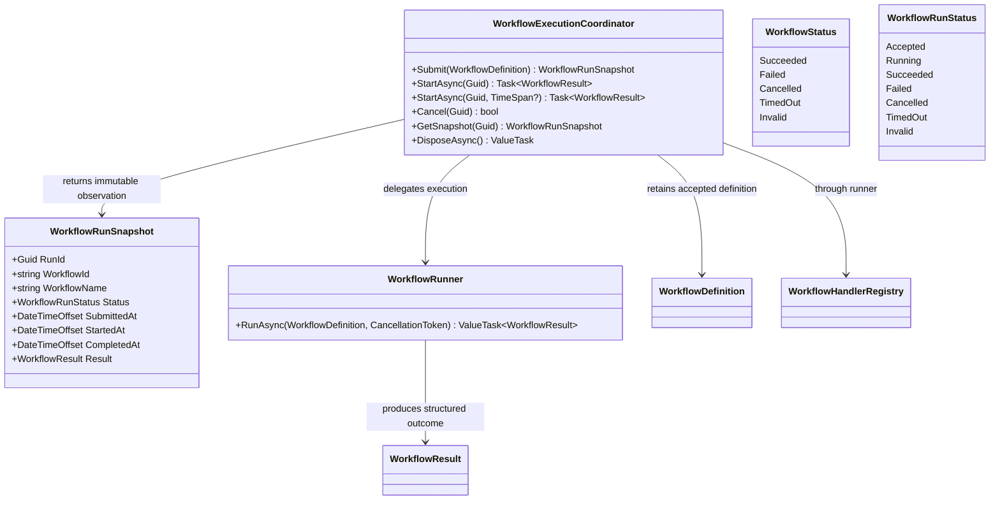

<!-- The Singularity Workshop moniker -->
<p align="center"><a href="https://github.com/TrentBest"></a></p>

# WorkflowExecutionCoordinator — UML Neighborhood

**Status:** source-grounded view of the current `development` implementation. The lifecycle coordinator and its tests passed [development CI run #84](https://github.com/TrentBest/TheSingularityWorkshop.Foundry/actions/runs/40546957980).

## Neighborhood



## Lifecycle sequence

```mermaid
sequenceDiagram
    participant Host
    participant Coordinator as WorkflowExecutionCoordinator
    participant Runner as WorkflowRunner
    participant Handler as Registered handler
    Host->>Coordinator: Submit(definition)
    Coordinator-->>Host: Accepted snapshot + run ID
    Host->>Coordinator: StartAsync(run ID, optional timeout)
    Coordinator->>Runner: RunAsync(definition, cancellation token)
    Runner->>Runner: Validate complete definition
    alt Invalid definition
        Runner-->>Coordinator: Invalid WorkflowResult
    else Valid definition
        loop Declared step order
            Runner->>Handler: Invoke registered handler
            Handler-->>Runner: Complete / fail / cancel
        end
        Runner-->>Coordinator: Terminal WorkflowResult
    end
    Host->>Coordinator: GetSnapshot(run ID)
    Coordinator-->>Host: Current status and result when available
    opt Workflow timeout elapses
        Coordinator->>Runner: Request linked-token cancellation
        Note over Coordinator,Handler: Cooperative only; a non-cooperative handler can continue running
    end
    Host->>Coordinator: Cancel(run ID) [optional]
    Note over Coordinator: Caller cancellation wins if both signals are requested before terminal commit
```

## Responsibility rules

- The coordinator owns retained run identity and lifecycle state for its lifetime.
- The existing runner remains the sole sequential step executor and definition validator.
- `WorkflowResult` remains the workflow outcome; `WorkflowRunStatus` adds lifecycle states such as `Accepted` and `Running`.
- The snapshot is observational and immutable. A presentation layer must send commands through the coordinator rather than mutate state.
- FSM_COS `RuntimeAssembly` and WebPage process-group updates are separate contracts; this diagram does not claim they are workflow definitions or results.

## Source and tests

- [Coordinator source](../../src/Foundry.Workflow/WorkflowExecutionCoordinator.cs)
- [Source companion](../../src/Foundry.Workflow/WorkflowExecutionCoordinator.md)
- [Lifecycle tests](../../tests/Foundry.Workflow.Tests/WorkflowExecutionCoordinatorTests.cs)
- [Workflow semantics](../WORKFLOW_SEMANTICS.md)

---

<!-- THE SINGULARITY WORKSHOP FOOTER -->
<p align="center"></p>
