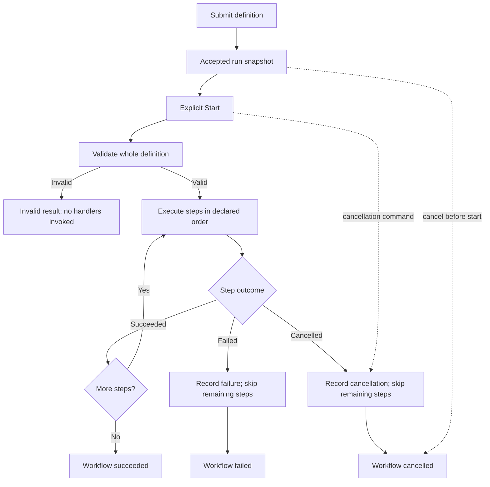

<!-- The Singularity Workshop moniker -->

# Workflow Semantics — Version 1

**Status:** implementation-backed theory for the first Foundry runtime slice. The sequential runner and retained run lifecycle coordinator passed the current [development CI run #84](https://github.com/TrentBest/TheSingularityWorkshop.Foundry/actions/runs/40546957980). This does not describe persisted manifests, distributed execution, or a general automation engine.

## The execution model

A workflow definition is data. It identifies the workflow, declares schema version 1, and lists ordered steps. Each step names a handler key; it does not contain code. The host registers the operations it is willing to expose through a WorkflowHandlerRegistry.

The existing `WorkflowRunner` remains the single authority for validating and executing sequential steps. `WorkflowExecutionCoordinator` adds the retained Hub-facing lifecycle around that runner: accept a definition, start it once, query an immutable status snapshot, request cancellation, and dispose the coordinator. It does not implement another step runner.

## Contract rules

1. **Validate before side effects.** Foundry checks required workflow identity/name, supported schema version, at least one step, unique step IDs, non-empty handler keys, and registration of every referenced handler before execution starts.
2. **The host owns capabilities.** A definition can name only a handler that the host registered. Registering a handler is an explicit host decision; the workflow does not grant itself filesystem, network, process, or publishing permissions.
3. **Order is semantic.** Version 1 executes steps sequentially in the declared order. It does not infer dependencies or run steps in parallel.
4. **Failure stops the sequence.** The failing step is recorded as failed and later steps are recorded as skipped. Foundry does not claim to roll back effects already performed by a handler.
5. **Cancellation is not failure.** A cancellation requested before or during a handler produces a cancelled outcome; remaining steps are skipped. Cancellation is cooperative.
6. **Invalid is not a run failure.** An invalid definition is rejected before any handler invocation and returns validation diagnostics without step results.
7. **Success is explicit.** The workflow result is successful only when every step succeeds.
8. **Errors are conservative by default.** The runtime records the exception type, not the exception message, because handler messages can accidentally contain secrets. A host may separately provide sanitized diagnostics under a deliberate policy.

## Retained execution lifecycle

`WorkflowExecutionCoordinator` exposes a host-neutral lifecycle without moving step execution out of `WorkflowRunner`:

- `Submit(definition)` accepts a definition but does not execute it. The returned snapshot starts in `Accepted`.
- `StartAsync(runId)` starts an accepted run exactly once without a workflow-level timeout.
- `StartAsync(runId, timeout)` starts an accepted run with an optional positive finite timeout or `Timeout.InfiniteTimeSpan`. A finite timeout requests cooperative cancellation and produces a distinct `TimedOut` result.
- `GetSnapshot(runId)` returns an immutable snapshot with run identity, workflow identity/name, lifecycle status, timestamps, and the latest structured result when available.
- `Cancel(runId)` requests cooperative cancellation for a running run, or marks an accepted-but-not-started run cancelled. It returns false for an already terminal run.
- `DisposeAsync()` cancels accepted/running work and waits for running handlers to finish. Handlers must honor cancellation for disposal to finish promptly.

Lifecycle statuses are `Accepted`, `Running`, `Succeeded`, `Failed`, `Cancelled`, `TimedOut`, and `Invalid`. The final workflow status remains the existing `WorkflowStatus`; the lifecycle enum does not replace or reinterpret step/workflow outcomes. Snapshots are observations, not mutable control objects. A presentation layer may display snapshots and send commands, but it does not own the authoritative state.

This is an in-process coordinator, not a durable queue or cross-process service. Run snapshots are retained only for the coordinator's lifetime.

## Outcome vocabulary

| Workflow status | Meaning |
|---|---|
| Succeeded | All declared steps completed successfully. |
| Failed | A handler failed; later steps were skipped. |
| Cancelled | Caller cancellation was requested; the current/remaining execution did not complete. |
| TimedOut | The workflow timeout elapsed and cooperative cancellation ended execution. |
| Invalid | Definition validation failed before execution. |

| Step status | Meaning |
|---|---|
| Succeeded | The registered handler returned normally. |
| Failed | The handler threw an exception not classified as requested cancellation. |
| Cancelled | The cancellation token was requested while the step was being considered/executed. |
| Skipped | The step was not invoked because an earlier step failed or execution was cancelled. |

## Deliberate limitations

- The definition is currently a typed in-memory object; there is no JSON/YAML or other persisted schema.
- The coordinator retains runs in memory only. It has no durable history, recovery after process loss, or cross-process query/command transport.
- The runtime has no retry, compensation, recovery, parallelism, or cross-process orchestration. Workflow timeouts are cooperative cancellation requests, not hard execution limits.
- A handler may perform external side effects. Validation prevents invocation for an invalid workflow but cannot make successful prior side effects transactional.
- Cancellation and timeout are cooperative: a handler must observe and honor its cancellation token. Foundry cannot forcibly stop a handler that ignores it. A timed-out run therefore remains Running until that handler returns.
- When caller cancellation and timeout are both requested before the coordinator commits the terminal state, caller cancellation takes precedence.
- Determinism is limited to the runner's declared order and outcome mapping; handler behavior and external systems may be nondeterministic.

## Source and verification

- [Definition contract](../src/Foundry.Workflow/WorkflowDefinition.cs)
- [Validation rules](../src/Foundry.Workflow/WorkflowValidator.cs)
- [Host capability registry](../src/Foundry.Workflow/WorkflowHandlerRegistry.cs)
- [Sequential runner and outcome mapping](../src/Foundry.Workflow/WorkflowRunner.cs)
- [Retained lifecycle coordinator](../src/Foundry.Workflow/WorkflowExecutionCoordinator.cs)
- [Runner tests](../tests/Foundry.Workflow.Tests/WorkflowRunnerTests.cs)
- [Lifecycle tests](../tests/Foundry.Workflow.Tests/WorkflowExecutionCoordinatorTests.cs)

The current [Foundry CI run #84](https://github.com/TrentBest/TheSingularityWorkshop.Foundry/actions/runs/40546957980) passed the runner and lifecycle tests, builds, and deterministic state-evidence checks. This document must be revised if the contract or tests change.

---

<!-- THE SINGULARITY WORKSHOP FOOTER -->

